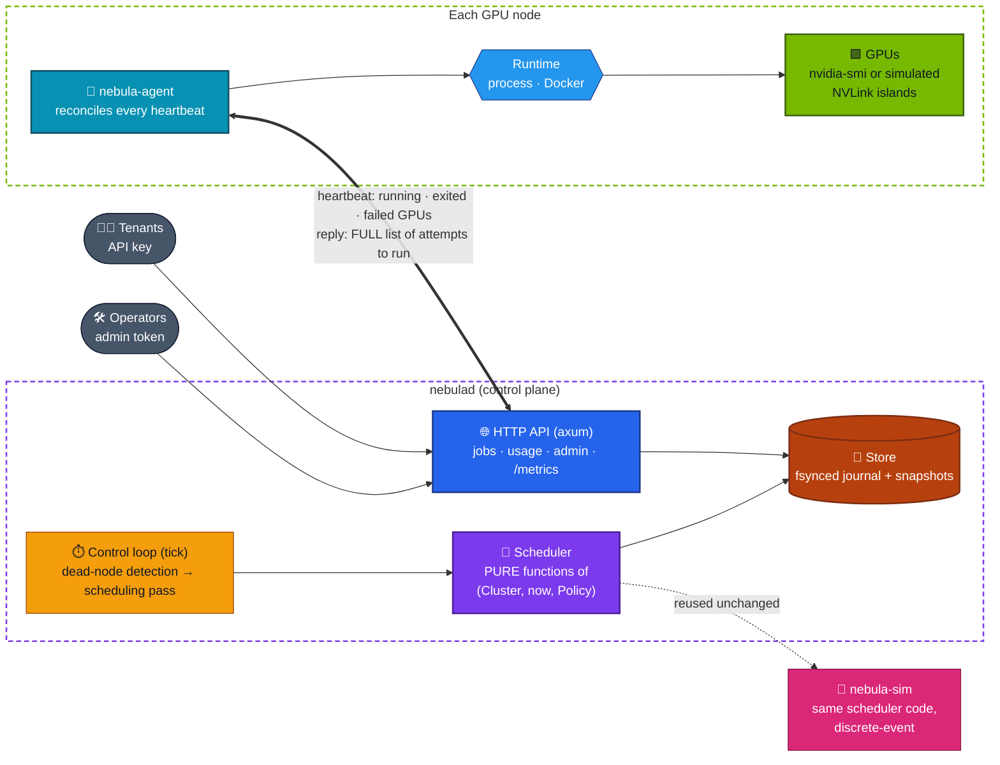
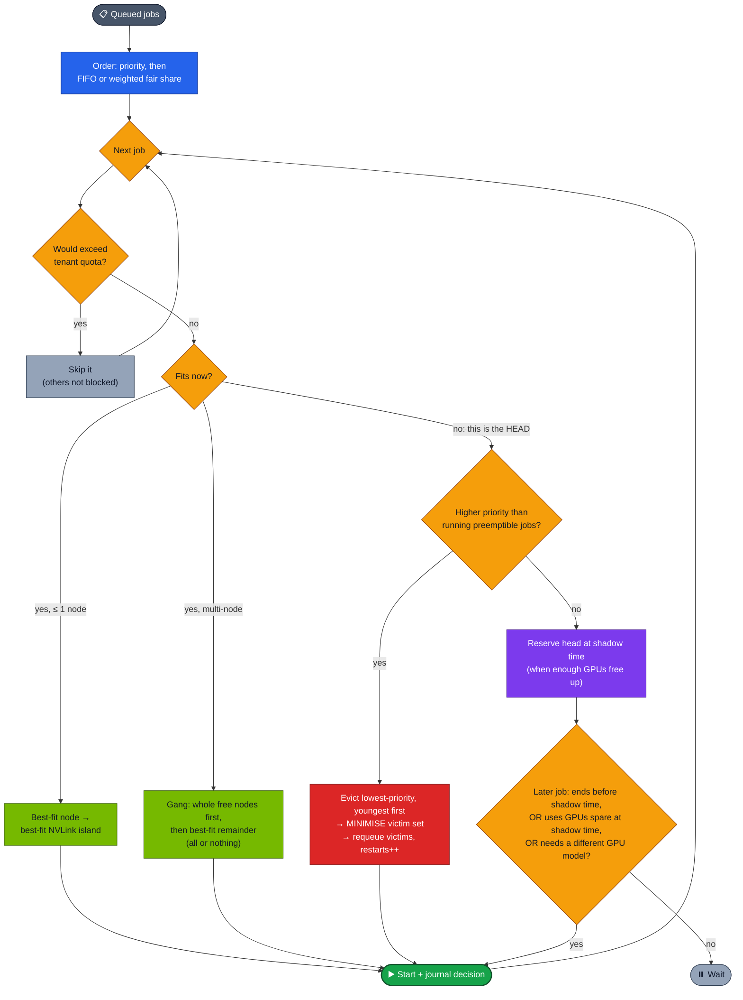
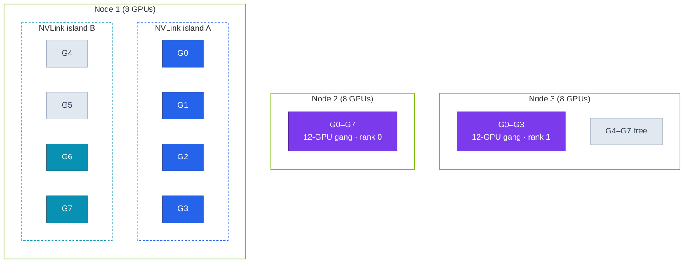
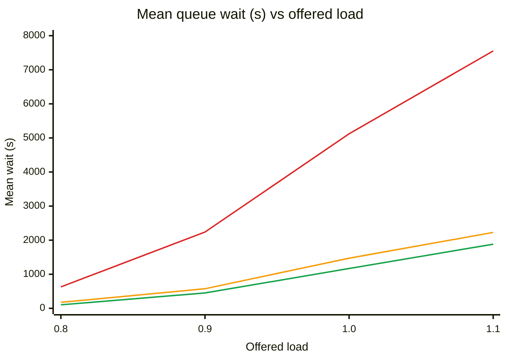
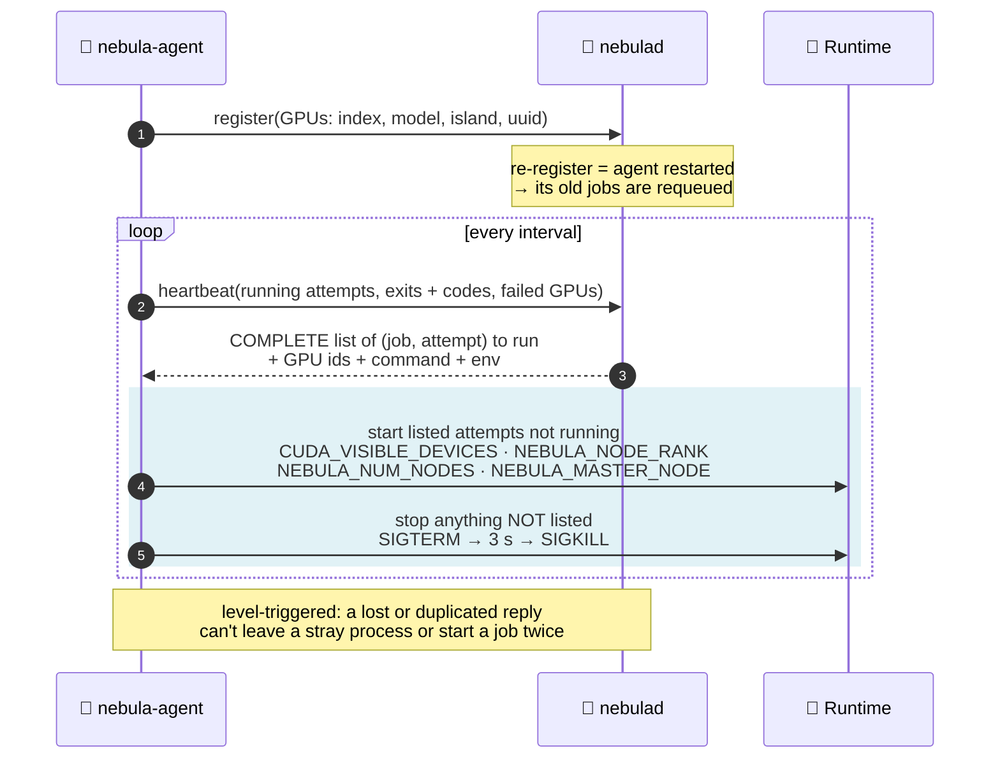
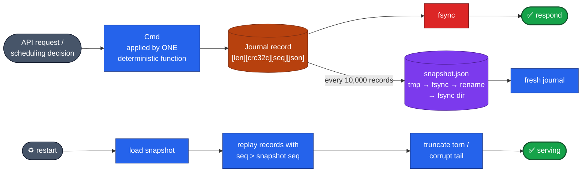

<div align="center">

# 🌌 Nebula GPU Cloud

### A control plane for multi-tenant GPU clusters in Rust: topology-aware gang scheduling, fair share, EASY backfill and minimal-victim preemption, with crash-safe state and sandboxed node agents

**`nebulad` scheduler + API · `nebula-agent` node runtime (process / Docker) · `nebula-sim` discrete-event policy simulator**

<br/>


[**Architecture**](#%EF%B8%8F-architecture) · [**Scheduler**](#-the-scheduler) · [**Results**](#-policy-results) · [**Agents**](#-node-agents) · [**Durability**](#-durability) · [**Testing**](#-testing) · [**Quick start**](#-quick-start)

</div>

---

## 📌 TL;DR

GPU clusters are expensive and contended. Who gets the GPUs, which GPUs, and what happens when a node dies are scheduling problems with real money attached. Nebula is a from-scratch control plane that answers them, and **a simulator that runs the exact same scheduler code** to measure each policy.

| | |
|---|---|
| 🧩 **Topology-aware placement** | Best fit across nodes, then **inside an NVLink island**; big jobs become all-or-nothing **gangs** over whole nodes |
| ⚖️ **Fairness** | Priority first, then **weighted fair share** (GPUs held ÷ weight, recomputed after every start), plus per-tenant **quotas** that never block others |
| ⏩ **EASY backfill** | The blocked head job gets a reservation at its *shadow time*; later jobs jump ahead only if they **can't delay it** |
| 🗡️ **Preemption** | Evicts lowest priority, then youngest, and then **minimises** the victim set (each victim is dropped again if the head still fits) |
| 💥 **Failures** | Dead nodes (missed heartbeats) and failed GPUs requeue their jobs, including every GPU of a multi-node gang |
| 💾 **Durability** | Every decision is journaled and **fsynced before the request returns**; snapshots + replay; crash-tested at every byte |
| 🤖 **Agents** | Level-triggered reconciliation; optional **hardened Docker runtime** (read-only, no caps, no network, non-root, CPU/mem/PID limits, `--gpus device=…`) |
| 🔬 **Simulator** | 4,000-job synthetic workloads × 5 policies × 4 load levels × 3 seeds, plus node failures and a 2,048-GPU cluster |

---

## 🏗️ Architecture



The scheduler is a set of **pure functions**, so the same code runs in the server, the simulator and the property tests. A scheduling pass is journaled as its **decisions** ("start job X on these GPUs", "preempt Y"), not as "run the scheduler", so replay doesn't depend on the configured policy.

---

## 🧠 The scheduler

### One scheduling pass



### Topology-aware placement



<sub>🟦 a 4-GPU job fills one NVLink island · 🟦 a 2-GPU job best-fits the other island · 🟪 a 12-GPU gang takes a whole node + 4 GPUs as ranks 0 and 1. Best fit keeps whole nodes free for future gangs.</sub>

**Invariants**, checked after *every* operation in the property tests: every running job holds exactly the GPUs it asked for, of the right model · no GPU is shared · node maps match placements · no tenant is over quota · nothing runs on a down node or a failed GPU.

---

## 📊 Policy results

`nebula-sim` · 32 nodes × 8 GPUs (2 NVLink islands each) · 4,000 jobs · mean of 3 seeds · Poisson arrivals, 1–32-GPU jobs, lognormal runtimes, one *heavy* tenant submitting half of all jobs.


<sub>🟥 FIFO · 🟧 FIFO + EASY backfill · 🟩 fair share + backfill</sub>

### At offered load 1.0

| Policy | Mean wait | p95 wait | **Light tenants' wait** | **High-priority wait** | Jobs on fewest nodes |
|---|:---:|:---:|:---:|:---:|:---:|
| FIFO | 5,121 s | 11,962 s | 5,140 s | 26 s | 76% |
| FIFO + backfill | 1,471 s | 9,204 s | 1,450 s | 42 s | 79% |
| **Fair share + backfill** | **1,169 s** | **7,157 s** | **216 s** | 32 s | 77% |
| … with first-fit placement | 1,705 s | 12,778 s | 292 s | 34 s | 63% |
| … **with preemption** | 1,327 s | 8,941 s | 242 s | **0 s** | 77% |

### What the numbers say

- ⏩ **Backfill is the largest single win:** mean wait **3.5× lower** than strict FIFO and bounded slowdown 16.5 → 4.1, at the same utilisation. A test proves the reserved head job is never delayed; this isn't just observed.
- ⚖️ **Fair share protects light tenants:** under FIFO + backfill every tenant waits about 1,450 s. With fair share the light tenants wait **216 s** and the heavy tenant 2,137 s. The heavy tenant pays for its own backlog.
- 🧩 **Topology placement is compact:** 76–91% of starts land on the minimum number of nodes (vs 63–64% for first fit), and 85–92% of small jobs stay in one island (vs 75–76%).
- 🗡️ **Preemption has a measured cost:** high-priority wait drops to **0 s**, but everyone else waits 9–47% longer and there are 123–382 preemptions per 4,000 jobs, because jobs don't checkpoint.
- 💥 **Node failures** (MTBF 100 h) cause 18–34 restarts per run and no stuck or lost jobs.

> [!NOTE]
> **An assumption, labelled as one:** the simulator *assumes* cross-island jobs run 1.1× slower and over-spread jobs 1.3× slower. A separate run removes that assumption, and then the two placement strategies give identical waits; compactness is only worth what real interconnects make it worth. Full tables (4 load levels, failures, a 2,048-GPU cluster): [`benchmarks.md`](docs/benchmarks.md)

### Control plane under load (real HTTP, real fsynced journal)

| Scenario | Submits/s | Submit p50 / p99 | Heartbeat p50 / p99 | Scheduling pass |
|---|:---:|:---:|:---:|:---:|
| 64 nodes · 50 submits/s | 51 | 4.4 / 12.6 ms | 0.2 / 3.6 ms | 0.2 ms |
| **256 nodes (2,048 GPUs) · 100 submits/s** | 101 | **4.6 / 34.5 ms** | **0.2 / 6.9 ms** | 0.6 ms |
| Closed-loop flood (overload) | 2,009 | 4.2 / 70.4 ms | 5.8 / 1,060 ms | 46 ms |

<sub>Under the flood, 39k jobs queue and p99 reaches about 1 s. The likely cause is contention on the single state lock, which is documented with the obvious fixes (incremental scheduling, a non-blocking lock, pruning finished jobs).</sub>

---

## 🤖 Node agents



**Hardened Docker runtime** (`--runtime docker`), each verified with `docker inspect` *and* from inside the container:

| Control | Setting |
|---|---|
| Identity | non-root `65534:65534` · `CapDrop ALL` · `no-new-privileges` |
| Filesystem | read-only root · 64 MiB `/tmp` tmpfs |
| Network | `--network none` (only `lo` visible) |
| Limits | CPU and memory from the job spec · PID limit 256 · OOM → job fails with a clear reason |
| GPUs | `--gpus device=<ids>` with renumbered `CUDA_VISIBLE_DEVICES` |
| Crash safety | containers orphaned by a `kill -9`'d agent are removed by its successor |

---

## 💾 Durability



If a journal write fails, the process **aborts rather than serve state that isn't on disk**. A crash between a snapshot rename and the journal reset is safe, because replay skips records by sequence number. The end-to-end test SIGTERMs `nebulad` mid-run and restarts it: a running job finishes **without restarting**, and its command runs exactly once.

---

## ✅ Testing

| Suite | Highlights |
|---|---|
| 🎲 **Scheduler property tests** (2 × 300 cases) | Random submits/completions/cancels/node-down/GPU-failures under **all 16 policy combinations**; invariants hold after every step; with hardware repaired, **every queued job runs within 500 passes** (no deadlock or starvation); compact placement is never split |
| 🎯 **Scheduler unit tests** (16) | Gangs all-or-nothing · backfill never delays the head · preemption set is **minimal**, not just a prefix · equal priority never preempts · quotas don't block others · fair-share weights |
| 💥 **Store tests** | **Journal cut at every byte** → recovers exactly the last whole record · replay = live state (64 random streams) · snapshot/journal crash window |
| 🌐 **End-to-end** (real processes) | Auth 401/403/404/422/400 · 4-GPU job in one island · 12-GPU gang as ranks 0+1 · preemption kills both ranks and restarts · **agent SIGKILL → requeue after timeout** · GPU failure · **control-plane restart mid-job** |
| 🐳 **Docker runtime** (real daemon) | Limits + hardening checked from inside and via `inspect` · cancel grace period · OOM kill · orphan cleanup · `nvidia-smi` detection |
| 🧬 **Mutation checks** | Ignoring the backfill reservation, not minimising the preemption set, not freeing GPUs, or using worst-fit islands: each makes a test fail |

---

## 🚀 Quick start

```sh
cargo build --release
./target/release/nebulad --config configs/example.json &
./target/release/nebula-agent --server http://127.0.0.1:7070 --token change-me-node \
     --id node-1 --gpus 8 --islands 2 &

# submit a 4-GPU job as tenant "research"
curl -s -H 'Authorization: Bearer change-me-research' -H 'content-type: application/json' \
     -d '{"gpus": 4, "est_runtime": 60, "command": ["sh", "-c", "echo $CUDA_VISIBLE_DEVICES; sleep 5"]}' \
     http://127.0.0.1:7070/v1/jobs                  # {"id":1}

curl -s -H 'Authorization: Bearer change-me-research' http://127.0.0.1:7070/v1/jobs/1
curl -s -H 'Authorization: Bearer change-me-research' http://127.0.0.1:7070/v1/usage
curl -s http://127.0.0.1:7070/metrics
```

<details>
<summary><b>🐳 Docker runtime, simulator, benchmarks</b></summary>

<br/>

```sh
# hardened container runtime (limits come from the job or the agent defaults)
./target/release/nebula-agent --server http://127.0.0.1:7070 --token change-me-node --id node-2 --gpus 8 \
     --runtime docker --image alpine:3.20 --default-memory-mb 512 &

# policy comparison
./target/release/nebula-sim --jobs 4000 --load 1.0 --seeds 3

# full benchmark suite → bench/results/<date>/ and docs/benchmarks.md
bench/run.sh

# tests (set NEBULA_REQUIRE_DOCKER=1 to fail instead of skip without Docker)
cargo test --release

# on a machine with a real NVIDIA GPU + Container Toolkit
scripts/owner_gpu_check.sh
```

</details>

<details>
<summary><b>🔌 API</b></summary>

<br/>

| Method | Path | Auth | Purpose |
|---|---|---|---|
| `POST` | `/v1/jobs` | tenant | Submit `{gpus, est_runtime, command, gpu_model?, priority?, preemptible?, image?, cpus?, memory_mb?}` |
| `GET` / `DELETE` | `/v1/jobs[/{id}]` | tenant | Own jobs only (others' return 404) / cancel |
| `GET` | `/v1/usage` | tenant | GPU-hours, GPUs in use, quota, jobs by state |
| `GET` | `/v1/admin/cluster`, `/v1/admin/usage` | admin | Nodes, GPU health, counters, all tenants' usage |
| `POST` / `DELETE` | `/v1/admin/nodes/{id}/drain` | admin | Drain / undrain |
| `POST` | `/v1/nodes/register`, `/v1/nodes/{id}/heartbeat` | node | Agent protocol |
| `GET` | `/metrics`, `/healthz` | — | Prometheus · liveness |

A tenant can't request a priority above its configured `max_priority` (default 0), so only trusted tenants can preempt. Secrets are compared in constant time.

</details>

---

## ⚠️ Limitations

- **No real GPU has run a job yet.** GPU detection was tested with a stand-in `nvidia-smi`, and `--gpus` pass-through is implemented but unverified on hardware ([`OWNER_ACTIONS.md`](docs/OWNER_ACTIONS.md) has the RTX 4060 check). There's no NVML/DCGM health and no NVLink topology auto-detection.
- **No fencing of partitioned nodes.** A partitioned agent keeps running a requeued job until its next heartbeat, so it can run twice.
- **One process, one lock, no HA.** Overload pushes p99 to about 1 s, and finished jobs are never pruned.
- **Security is minimal:** static bearer tokens, a shared node token, no TLS or mTLS. The `process` runtime has no isolation; use `--runtime docker`.
- **Preemption kills; it doesn't checkpoint.** Gang completion follows rank 0's exit code.
- The simulator's slowdown factors are **assumptions**, and its workload is synthetic, not a production trace.

Full list: [`limitations.md`](docs/limitations.md) · Requirements: [`requirements.md`](docs/requirements.md) · Design: [`architecture.md`](docs/architecture.md) · Tests: [`testing.md`](docs/testing.md)

---

## 📁 Repository layout

```text
NEBULA_GPU_CLOUD/
├── src/
│   ├── model.rs      🧱 cluster, nodes, GPUs, tenants, jobs
│   ├── sched.rs      🧠 scheduler (pure functions) + invariant checker
│   ├── store.rs      💾 commands, journal, snapshots, recovery
│   ├── server.rs     🌐 HTTP API, control loop, node protocol
│   ├── sim.rs        🔬 workload model + discrete-event simulator
│   ├── runtime.rs    🐳 hardened Docker runtime
│   ├── gpu.rs        🟩 nvidia-smi discovery
│   └── bin/          ⚙️ nebulad · nebula-agent · nebula-sim · nebula-bench
├── tests/            ✅ sched (proptest) · store · sim · e2e · agent_runtime (Docker)
├── bench/            📊 run.sh · report.py · results/
├── scripts/          🧪 owner_gpu_check.sh
└── docs/             📖 architecture · testing · benchmarks · limitations · requirements
```

---

<div align="center">

**Same scheduler in the server, the simulator and the property tests, so every policy claim is measured on the code that ships.**

<br/>

Built by **[Siddhant Singh](https://github.com/siddhaantxsingh)** · <sub>MIT License</sub>

</div>
