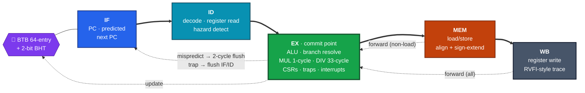
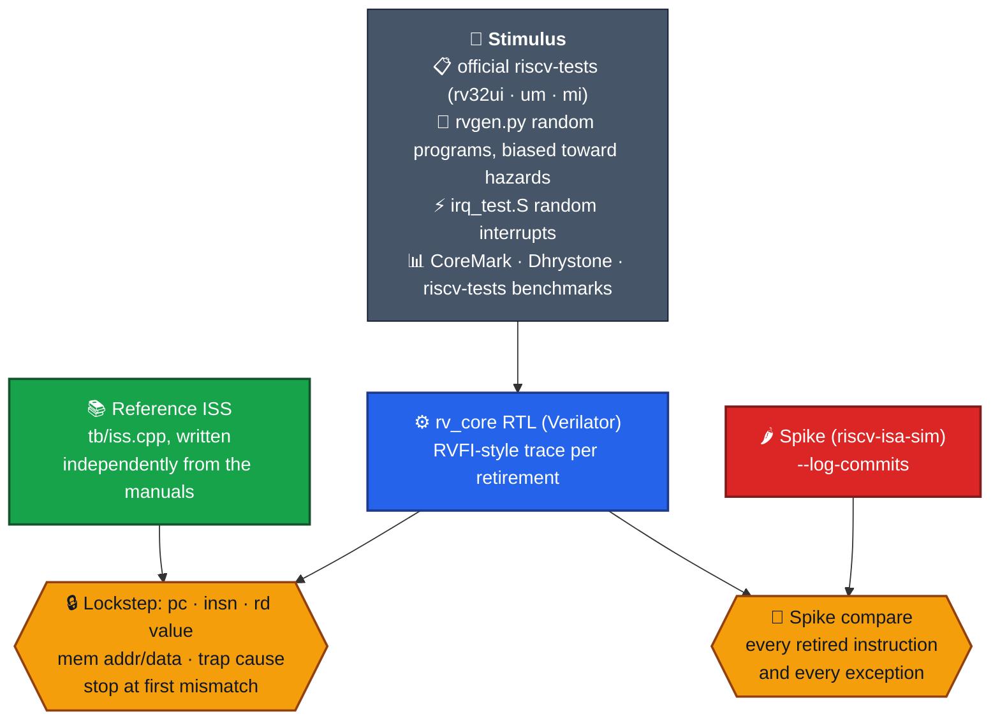
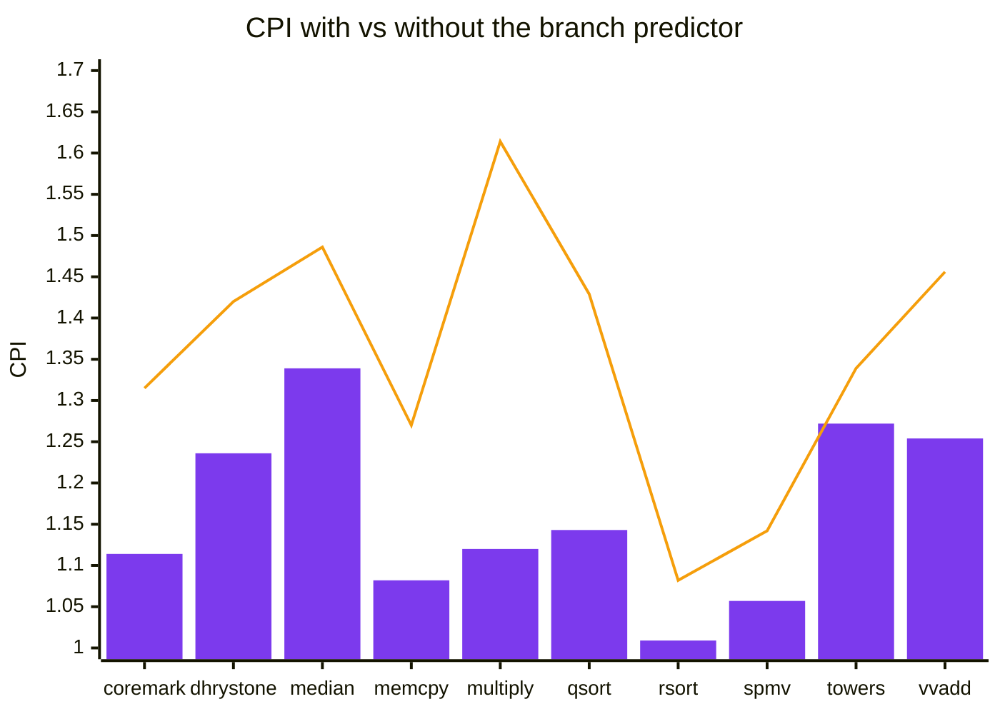
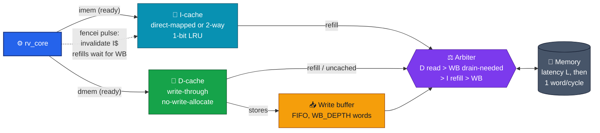
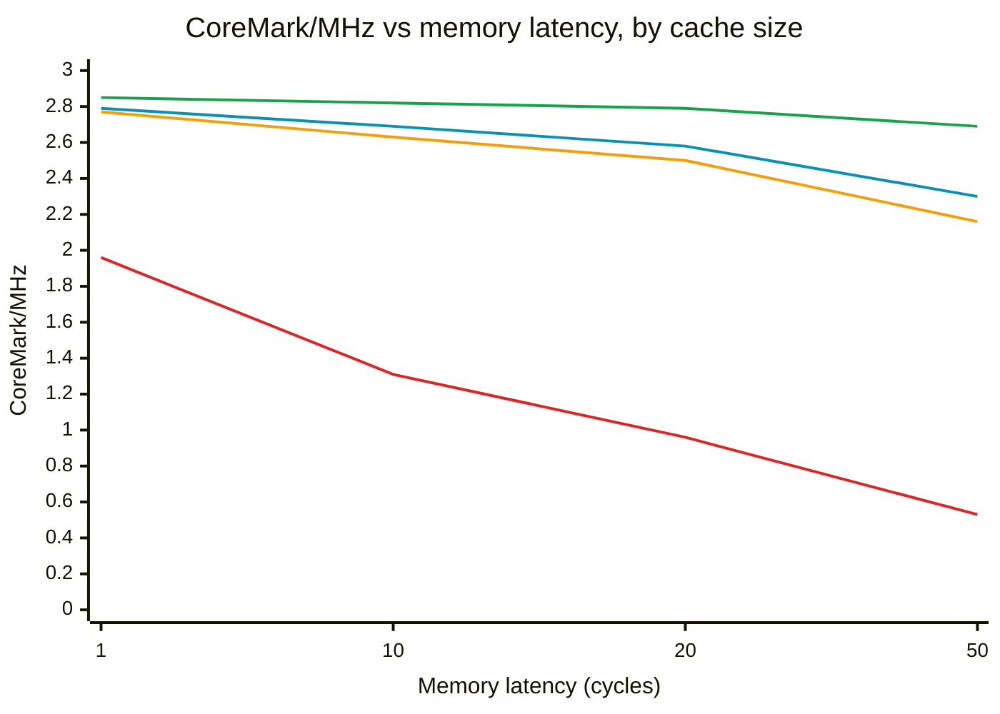
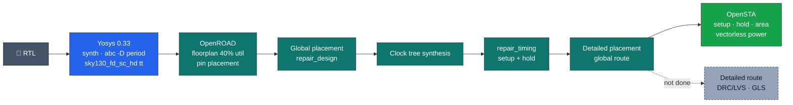
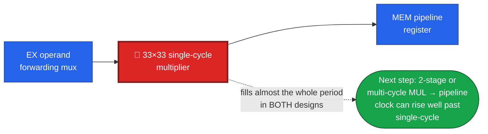

<div align="center">

# 🧠 rv_core: a verified 5-stage RV32IM CPU

### A RISC-V core written from scratch in SystemVerilog, checked instruction by instruction against two independent reference models, with caches and taken through a sky130 physical-design flow

**RV32IM · Zicsr · Zifencei · Zicntr · full forwarding · BTB + 2-bit predictor · precise traps · vectored interrupts · I/D caches + write buffer**

<br/>


[**Pipeline**](#%EF%B8%8F-microarchitecture) · [**Verification**](#-verification-four-independent-checks) · [**Performance**](#-performance) · [**Caches**](#-memory-system-caches--write-buffer) · [**Physical design**](#-physical-design-sky130hd) · [**Run it**](#-running-it)

</div>

---

## 📌 TL;DR

| | |
|---|---|
| 🏗️ **Core** | 5-stage in-order pipeline (IF · ID · EX · MEM · WB), full forwarding, one-bubble load-use, 64-entry BTB + 2-bit counters, single-cycle 33×33 multiply, 33-cycle radix-2 divide |
| ⚡ **Privileged** | Machine mode · precise exceptions committed at EX · vectored interrupts (MEI > MSI > MTI) · `mcycle`/`minstret` · FENCE.I |
| 🧪 **Verified by** | **Every retired instruction** compared live against an independent C++ ISS · official riscv-tests · constrained-random programs cross-checked against **Spike** · random-interrupt stress |
| 🗃️ **Memory system** | Optional I-cache + write-through D-cache + write buffer + arbiter (`rv_top`), parameterised size/ways/line, with a configurable-latency memory model |
| 📊 **Performance** | **2.87 CoreMark/MHz** · 1.22 DMIPS/MHz · CPI 1.01–1.34 |
| 🔬 **Silicon-style flow** | sky130hd synthesis → placement → CTS → global route → STA: **43.5 MHz**, 328,883 µm², about 50 mW |
| ⚖️ **Honest comparison** | A single-cycle baseline (`rv_single`) for an IPC × Fmax study, which showed the pipeline **barely wins**, and exactly why |

---

## 🏗️ Microarchitecture



- **Precise traps:** EX is the commit point. An excepting or interrupted instruction updates `mepc`/`mcause`/`mtval`/`mstatus`, flushes IF and ID, and continues to WB as a *trap record* with no side effects. Older instructions in MEM and WB complete normally.
- **System instructions drain the pipeline** (CSR, ECALL, MRET, FENCE.I…), so they can read `minstret` exactly and trap without any rollback, at a cost of at most 3 cycles.
- **Stall-aware memory ports:** `imem_ready` / `dmem_ready` let the same core run on idealised memory or behind caches. A divide finishing during a memory stall is held in a register.
- **Trace port:** every instruction leaving WB produces an RVFI-style record (pc, encoding, next pc, rd + value, memory address/mask/data, trap cause). This is what makes lockstep verification possible.

Details: [`microarchitecture.md`](docs/microarchitecture.md)

---

## 🧪 Verification: four independent checks



> **Why two reference models?** The RTL and the in-house ISS share an author, so a misreading of the spec could appear in both and pass lockstep. **Spike is the independent tiebreaker.**

| Check | Result |
|---|---|
| ✅ **riscv-tests** in lockstep | **64/64 pass**, plus 2 expected-by-design failures checked as such (no misaligned-access hardware, zero PMP entries) |
| ✅ **Random programs vs ISS** | **250/250** on 3 predictor configs (normal, aliasing-heavy 4-entry BTB, predictor off), about 210k retirements |
| ✅ **Random programs vs Spike** | **400/400 identical** (335,326 events), and 400/400 on two cached builds and on the single-cycle core |
| ✅ **riscv-tests vs Spike** | 62/64 match; the 2 diffs are implementation-defined (debug triggers, `marchid`) |
| ✅ **Interrupt stress** | 8 seeds × about 12,000 random interrupts, direct **and** vectored `mtvec`, every one precise; the program checks that its own count equals the harness's |
| ✅ **Benchmarks under lockstep** | CoreMark (CRCs validated) and riscv-tests benchmarks, with and without the predictor |
| ✅ **Lint** | `verilator --lint-only -Wall` clean; Yosys parses and maps |

Details: [`verification.md`](docs/verification.md)

---

## 📊 Performance

<table>
<tr>
<td width="50%" valign="top">

| Benchmark | Result |
|---|---|
| **CoreMark** (2K perf run, CRCs ✔) | **2.87 /MHz** |
| CoreMark, no predictor | 2.43 /MHz |
| **Dhrystone** (riscv-tests build) | **1.22 DMIPS/MHz** |
| CPI, CoreMark | 1.114 |
| CPI range, riscv-tests benchmarks | 1.009 – 1.339 |

</td>
<td width="50%" valign="top">

| Yosys `synth_ecp5` | Count |
|---|---|
| LUT4 | 6,348 |
| Flip-flops | 1,647 |
| LUT-RAM 16×4 | 92 |
| DSP (MULT18X18D) | 4 |

</td>
</tr>
</table>


<sub>🟪 bars: BTB + 2-bit BHT · 🟧 line: predictor disabled. Without a return-address stack, returns predict the BTB's last target, which explains most of Dhrystone's 25% mispredict rate.</sub>

<sub>CoreMark here means iterations per million <i>simulated</i> cycles. The run is too short to be an official score. Method: <a href="docs/benchmarks.md"><code>benchmarks.md</code></a></sub>

---

## 🗃️ Memory system: caches + write buffer



**Ordering rules that keep it correct:** a D-cache read waits for an empty write buffer; store hits update the line in the same cycle; FENCE.I invalidates the I-cache and drops any in-flight refill. Write-through was chosen over write-back so FENCE.I and host (HTIF) reads need no dirty-line walk ([`caches.md`](docs/caches.md)).


<sub>🟥 256 B direct-mapped · 🟧 1 KiB direct-mapped · 🟦 1 KiB 2-way · 🟩 4 KiB direct-mapped. The idealised core reaches 2.87. With 4 KiB caches, going from 1 to 50 cycles of latency costs CoreMark only 6%; with 256 B it costs 73%. Full sweep: <a href="docs/caches_results.md"><code>caches_results.md</code></a></sub>

**Cache verification:** riscv-tests + 400 random programs + a directed cache-corner test + interrupt stress, all in lockstep on **3 cache configurations × 3 memory latencies**; Spike 400/400 on two of them. **Bug injection: 9/9 hand-picked cache bugs caught**, including "store hit doesn't update the line", "FENCE.I doesn't invalidate", "tag compare uses only 4 bits" and "refill installs one beat early".

---

## 🔬 Physical design (sky130hd)



| Top | Met clock | Setup WNS | Cells | Flip-flops | Placed area | Power (vectorless) |
|---|:---:|:---:|:---:|:---:|:---:|:---:|
| `rv_core` (pipelined) | **23 ns · 43.5 MHz** | +0.082 ns | 32,361 | 5,863 | 328,883 µm² | 50.4 mW |
| `rv_single` (single-cycle) | **26 ns · 38.5 MHz** | +1.081 ns | 15,684 | 1,491 | 152,845 µm² | 13.6 mW |
| `rv_top` (core + 256 B I$/D$) | **23 ns · 43.5 MHz** | +1.391 ns | 52,250 | 11,143 | 590,858 µm² | 53.4 mW |

### ⚖️ The honest finding: pipelining barely paid off, and why

| Design | Fmax | CoreMark/MHz | **CoreMark iterations/s at Fmax** |
|---|:---:|:---:|:---:|
| Pipelined `rv_core` | 43.5 MHz | 2.87 | **125** |
| Single-cycle `rv_single` | 38.5 MHz | 3.19 | **123** |



Pipelining removes decode and memory time from the cycle, but the single-cycle multiplier is the critical path either way. The pipeline also adds CPI through mispredictions and load-use bubbles. **The measurement found the bottleneck**, and the README says so instead of hiding the result. Details: [`timing.md`](docs/timing.md)

---

## 🚀 Running it

**Tools:** Verilator 5 · `riscv64-unknown-elf-gcc` + `picolibc` (Ubuntu: `gcc-riscv64-unknown-elf picolibc-riscv64-unknown-elf`) · Yosys · Python 3

```bash
make fetch                    # riscv-tests + CoreMark at pinned commits
make test                     # riscv-tests + random + interrupts + predictor variants, all in lockstep
make test-spike SPIKE=/path/to/spike     # cross-check against Spike
make bench synth report       # benchmarks, synthesis, docs/benchmarks.md
make test-cache-all           # 3 cache configurations, lockstep
make test-cache CACHE=32:2:32:2:4:4 MEMLAT=30   # any cache config + memory latency
make test-single              # single-cycle baseline
python3 tools/mutate-cache.py # cache bug injection
flow/scripts/sweep_lite.sh rv_core_pd 23        # sky130hd timing (see flow/env.sh.example)
obj_dir/Vrv_core program.elf  # run any bare-metal rv32im ELF linked at 0x80000000
```

The harness's memory map, HTIF exit convention and options are documented at the top of [`tb/sim_main.cpp`](tb/sim_main.cpp).

---

## 📁 Repository layout

```text
RISCV-CPU/
├── rtl/       ⚙️  rv_core.sv (pipeline, CSRs, predictor) · rv_decode.sv · rv_alu.sv (ALU/MUL/DIV)
│                  rv_cache.sv (I/D caches, write buffer, arbiter, rv_top) · rv_single.sv (baseline)
├── tb/        🧪  Verilator harness (ELF loader, HTIF, MMIO, lockstep) · reference ISS
├── tools/     🛠️  rvgen.py · spike-compare.py · mutate-cache.py · cache-sweep · report
├── tests/     📋  interrupt stress · cache corner cases · self-modifying code
├── sw/        💾  crt0 · linker script · runtime · CoreMark port
├── flow/      🔬  sky130hd reduced PD flow + results
├── synth/     🧱  Yosys script
├── results/   📊  recorded benchmark, sweep and synthesis outputs
└── docs/      📖  microarchitecture · verification · benchmarks · caches · timing · limitations
```

---

## ⚠️ Limitations

- **No FPGA bitstream, no silicon, no gate-level simulation.** Physical design stops after global routing (no detailed route, DRC/LVS or RC extraction; typical corner only).
- **Combinational memory reads.** Caches are flip-flop arrays; real SRAM macros with registered reads would need an extra fetch stage.
- **Machine mode only.** No U/S modes, virtual memory or PMP entries; misaligned accesses trap.
- **No formal verification and no coverage metric.** Verification is lockstep, Spike and directed/random tests.
- **No return-address stack.** The single-cycle multiplier limits Fmax (see above).
- **Short benchmarks.** These are simulated-cycle CoreMark figures, not official scores.

Full list: [`limitations.md`](docs/limitations.md) · Requirements: [`requirements.md`](docs/requirements.md)

---

<div align="center">

**Every instruction checked. Every number measured. Every bottleneck named.**

<br/>

Built by **[Siddhant Singh](https://github.com/siddhaantxsingh)** · B.Tech ECE (VLSI Design & Technology), MIT Manipal · <sub>MIT License</sub>

</div>
